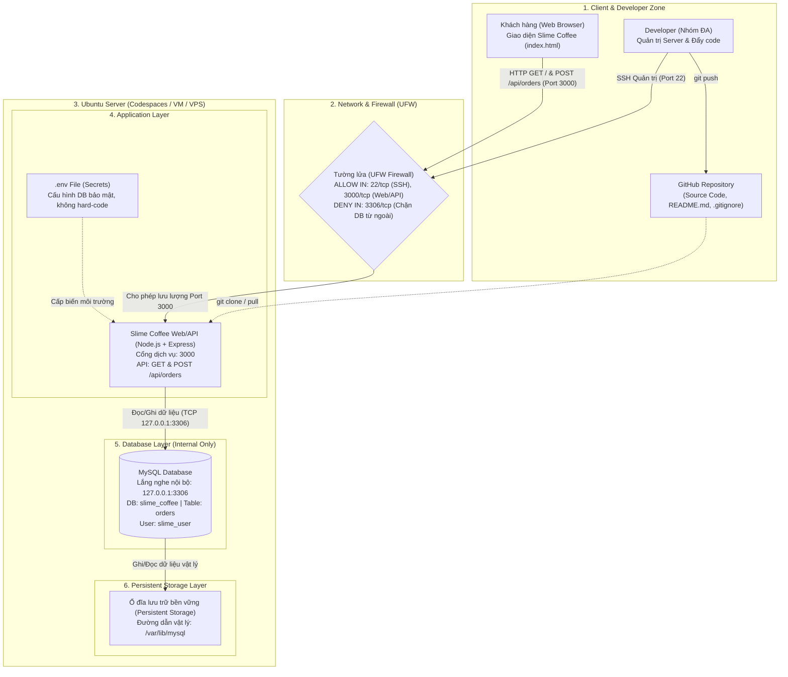

# ☕ Slime Coffee — Web Application & Order Management System

> **Môn học:** DevOps  
> **Học kỳ:** 2026  
> **Hình thức:** Group Project  
> **Giai đoạn:** Checkpoint Week 1 — Infrastructure Setup & Initial Deployment  
> **Điểm tối đa checkpoint:** 2.0 / 10.0 điểm toàn đồ án  

---

## 1. Bối cảnh Ứng dụng & Nguồn Mã nguồn (Project Overview & Source)

### 1.1. Bối cảnh Ứng dụng
**Slime Coffee** là ứng dụng Web đặt món cà phê và bánh ngọt trực tuyến, được lấy cảm hứng từ linh vật *Slime Bá Vương* thân thiện. Hệ thống phục vụ các chức năng chính:
- Xem thông tin giới thiệu, câu chuyện thương hiệu và danh sách món bán chạy (**Best Seller**).
- Duyệt thực đơn món (Đồ uống, Bánh ngọt), tăng giảm số lượng món và mở popup kiểm tra tổng tiền dự kiến.
- Đặt món trực tuyến: Hệ thống tự động sinh mã đơn duy nhất (`orderId` dạng `#SC-YYMMDD-XXXX`) và thực hiện thao tác **Ghi (WRITE)** vào cơ sở dữ liệu quan hệ MySQL.
- Tra cứu lịch sử đơn hàng: Hệ thống thực hiện thao tác **Đọc (READ)** danh sách các mã đơn hàng đã đặt thành công từ MySQL hiển thị lên giao diện.

### 1.2. Nguồn Code & Phạm vi Tự Triển khai
- **Nguồn mã nguồn:** Mã nguồn do nhóm tự thiết kế giao diện và lập trình từ đầu, không sử dụng template dựng sẵn:
  - **Frontend:** HTML5, CSS3 thuần (sử dụng hệ thống Design Tokens nhất quán), JavaScript Vanilla (xử lý SPA State Management và gọi Fetch API).
  - **Backend API:** Node.js kết hợp Express framework (`server.js`).
  - **Cơ sở dữ liệu:** MySQL Server (sử dụng thư viện kết nối `mysql2/promise`).
- **Phạm vi tự triển khai:**
  - Khởi dựng môi trường máy chủ Linux (Ubuntu 24.04 LTS).
  - Cấu hình mạng, phân quyền cổng và thiết lập chính sách tường lửa bảo vệ hệ thống (`UFW`).
  - Cài đặt, cấu hình và bảo mật cơ sở dữ liệu MySQL (phân quyền user riêng, tạo bảng `orders`).
  - Tách biệt bí mật hệ thống và cấu hình thông qua biến môi trường (`.env`), cam kết không hard-code thông tin nhạy cảm lên Git.
  - Kết nối ứng dụng với Database, chứng minh đọc/ghi bản ghi thực tế.

---

## 2. Bảng Phân công Nhiệm vụ Thành viên (Team Responsibilities)

| STT | Họ và Tên | Mã Sinh Viên | Vai trò chính | Nhiệm vụ cụ thể (Tuần 1) |
| :-: | :--- | :-: | :--- | :--- |
| 1 | **Nguyễn Ánh Ngọc** | *23090016* | **Backend & Database** | - Xây dựng REST API bằng Express (`server.js`) xử lý các endpoint: `POST /api/orders` (ghi đơn) và `GET /api/orders` (đọc lịch sử).<br>- Khởi tạo cơ sở dữ liệu `slime_coffee`, thiết kế bảng `orders`.<br>- Cấu hình tài khoản người dùng nội bộ `slime_user`, phân quyền hợp lý và kết nối bảo mật qua biến môi trường `.env`. |
| 2 | **Nguyễn Thị Quỳnh Mỹ** | *23090034* | **Frontend & Ubuntu Deployment** | - Xây dựng và hoàn thiện giao diện người dùng (`index.html`, `style.css`) theo bộ nhận diện Slime Coffee.<br>- Triển khai ứng dụng trên máy chủ Ubuntu, cấu hình và kích hoạt tường lửa `UFW` (mở port 22, port 3000, bảo mật port 3306).<br>- Kiểm thử luồng gọi API và thu thập hình ảnh/video minh chứng hoạt động. |
| 3 | **Trương Thủy Lam** | *23090018* | **System Architecture** | - Khảo sát và thiết kế sơ đồ kiến trúc triển khai hệ thống (Client, Network/Firewall, Ubuntu Server, App, Database, Storage).<br>- Phân tích luồng truyền nhận dữ liệu, giải thích cơ chế bảo mật và đóng gói tài liệu sơ đồ kiến trúc (`architecture.png`/`pdf`).<br>- Hỗ trợ kiểm tra tài liệu và chuẩn bị nội dung kỹ thuật cho buổi bảo vệ (defense). |

---

## 3. Kiến trúc Triển khai (Deployment Architecture — Week 1)

Kiến trúc triển khai Tuần 1 tuân thủ mô hình phân tầng chặt chẽ: **Client → Firewall (UFW) → Ubuntu Server → Web/API (Node.js) → Database (MySQL) → Persistent Storage**.



---

## 4. Thông số Máy chủ & Cấu hình Mạng (Server Specs & Networking)

- **Hệ điều hành:** Ubuntu 24.04.5 LTS (Noble Numbat)
- **Tài nguyên máy chủ:**
  - **CPU:** 2 vCPU
  - **RAM:** 2.0 GB
  - **Dung lượng đĩa (Storage):** 10 GB
- **Cấu hình Cổng (Ports) & Tường lửa (UFW Firewall):**
  - `Default Incoming Policy`: **DENY** (Chặn toàn bộ các kết nối trái phép từ bên ngoài).
  - `Default Outgoing Policy`: **ALLOW** (Cho phép máy chủ kết nối Internet để cập nhật package).
  - `Port 22/tcp`: **ALLOW IN** (Dành riêng cho giao thức SSH để nhóm quản trị máy chủ).
  - `Port 3000/tcp`: **ALLOW IN** (Mở cho người dùng truy cập Web và gọi REST API).
  - `Port 3306/tcp (MySQL)`: **DENY IN / KHÔNG MỞ RA NGOÀI** (Chỉ cho phép ứng dụng Node.js kết nối nội bộ qua địa chỉ loopback `127.0.0.1`).

---

## 5. Hướng dẫn Triển khai Thủ công Chi tiết (Step-by-Step Manual Deployment)

Hướng dẫn này dùng để cài đặt và tái tạo ứng dụng trên một máy chủ Ubuntu mới hoàn toàn.

### Bước 1: Cấu hình Tường lửa (UFW Firewall)
Cập nhật danh sách gói và thiết lập tường lửa bảo vệ máy chủ:
```bash
sudo apt update && sudo apt install -y ufw

# Thiết lập chính sách mặc định
sudo ufw default deny incoming
sudo ufw default allow outgoing

# Mở các cổng cần thiết theo thiết kế kiến trúc
sudo ufw allow 22/tcp
sudo ufw allow 3000/tcp

# Bật tường lửa
sudo ufw enable

# Xác minh trạng thái tường lửa (Lấy minh chứng nộp bài)
sudo ufw status verbose
```

### Bước 2: Cài đặt Node.js và MySQL Server
Cài đặt môi trường runtime, trình quản lý gói và hệ quản trị cơ sở dữ liệu:
```bash
sudo apt install -y nodejs npm mysql-server git

# Khởi động dịch vụ MySQL
sudo service mysql start

# Kiểm tra trạng thái MySQL
sudo service mysql status
```

### Bước 3: Khởi tạo Database, Bảng và Phân quyền
Đăng nhập vào MySQL với quyền root:
```bash
sudo mysql -u root
```

Thực thi khối lệnh SQL sau:
```sql
-- 1. Tạo cơ sở dữ liệu
CREATE DATABASE IF NOT EXISTS slime_coffee CHARACTER SET utf8mb4 COLLATE utf8mb4_unicode_ci;

-- 2. Tạo tài khoản người dùng riêng (Không dùng root cho ứng dụng)
CREATE USER IF NOT EXISTS 'slime_user'@'localhost' IDENTIFIED BY '221105';
ALTER USER 'slime_user'@'localhost' IDENTIFIED BY '221105';

-- 3. Cấp quyền truy cập trên database slime_coffee
GRANT ALL PRIVILEGES ON slime_coffee.* TO 'slime_user'@'localhost';
FLUSH PRIVILEGES;

-- 4. Tạo bảng orders lưu trữ đơn hàng
USE slime_coffee;

CREATE TABLE IF NOT EXISTS orders (
  id INT AUTO_INCREMENT PRIMARY KEY,
  order_id VARCHAR(50) NOT NULL UNIQUE,
  items JSON NOT NULL,
  total_amount INT NOT NULL,
  created_at VARCHAR(50) NOT NULL,
  status VARCHAR(30) DEFAULT 'SUCCESS'
);

EXIT;
```

### Bước 4: Tải Mã nguồn & Cấu hình Biến môi trường
Clone repository của nhóm về máy chủ:
```bash
git clone [https://github.com/IvyPear/SlimeCoffee.git](https://github.com/IvyPear/SlimeCoffee.git)
cd SlimeCoffee

# Cài đặt các thư viện dependencies (express, mysql2, dotenv)
npm install
```

Tạo file biến môi trường `.env` từ file mẫu `.env.example`:
```bash
cp .env.example .env
nano .env
```

Điền các thông số kết nối bí mật (tuyệt đối không commit file này lên Git):
```env
PORT=3000
DB_HOST=127.0.0.1
DB_PORT=3306
DB_USER=slime_user
DB_PASSWORD=221105
DB_NAME=slime_coffee
```
*(Nhấn `Ctrl + O` rồi `Enter` để lưu, `Ctrl + X` để thoát nano).*

### Bước 5: Khởi chạy Ứng dụng
Khởi chạy dịch vụ Node.js:
```bash
npm start
```

Khi Terminal xuất hiện thông báo:
```text
✓ Đã kết nối MySQL thành công và sẵn sàng bảng orders!
Slime Coffee Server đang chạy tại http://localhost:3000
```
Hệ thống đã triển khai thành công và sẵn sàng nhận kết nối từ người dùng.

---

## 6. Kiểm thử & Minh chứng Hoạt động (Verification & Evidence)

### 6.1. Kiểm thử Đọc/Ghi dữ liệu qua Giao diện Web
1. Mở trình duyệt web và truy cập vào địa chỉ: `http://<IP_MAY_CHU>:3000` (hoặc domain chuyển tiếp cổng từ Codespaces).
2. Chuyển sang trang **Menu**, chọn món bằng nút `+` (ví dụ: *1x Mint Slime Cream Latte*, *1x Slime Pudding Bạc Hà*).
3. Bấm vào thanh nổi **"Chọn món"** → xem lại danh sách trong popup → bấm **"Xác nhận đặt món"**.
4. Ứng dụng gửi HTTP POST request đến `/api/orders`. Khi ghi dữ liệu thành công, popup **"Đặt Món Thành Công!"** hiển thị kèm mã đơn hàng duy nhất (ví dụ: `#SC-261018-4821`).
5. Chuyển sang mục **"Lịch sử đơn hàng"**, hệ thống gửi HTTP GET request đến `/api/orders` và hiển thị mã đơn hàng vừa tạo lên đầu danh sách.

### 6.2. Minh chứng Kiểm tra Bản ghi Trực tiếp trong MySQL
Xác minh dữ liệu đã được lưu bền vững vào bảng vật lý trong MySQL:
```bash
sudo mysql -u slime_user -p221105 -D slime_coffee -e "SELECT id, order_id, total_amount, created_at, status FROM orders;"
```

**Bảng dữ liệu mẫu xuất ra:**
```text
+----+-------------------+--------------+-----------------------+---------+
| id | order_id          | total_amount | created_at            | status  |
+----+-------------------+--------------+-----------------------+---------+
|  1 | SC-261018-4821    |        84000 | 19:15:30 18/10/2026   | SUCCESS |
+----+-------------------+--------------+-----------------------+---------+
```

---

## 7. Cấu trúc Thư mục Dự án (Project Directory Structure)

```text
SlimeCoffee/
├── public/
│   ├── index.html          # Giao diện SPA (Trang chủ, Menu, Lịch sử đơn hàng, Popups)
│   └── style.css           # Bảng mã CSS Design Tokens nhận diện Slime Coffee
├── .env            # Cấu hình biến môi trường mẫu (không chứa mật khẩu thật)
├── package.json            # Khai báo cấu hình dự án và dependencies
├── package-lock.json       # Khóa phiên bản thư viện chính xác
├── server.js               # Backend REST API kết nối MySQL Server
└── README.md               # Tài liệu báo cáo và hướng dẫn kỹ thuật Checkpoint Tuần 1
```

---

## 8. Nguyên tắc An toàn & Bảo mật (Security Guidelines)

- **Không đưa thông tin bí mật lên Git:** File `.env` chứa mật khẩu database đã được cấu hình trong `.gitignore` để không bị đẩy lên GitHub repository. Chỉ giữ file `.env.example` làm mẫu cấu hình.
- **Nguyên tắc phân quyền tối thiểu (Least Privilege):** Ứng dụng Node.js kết nối vào database qua tài khoản riêng `slime_user`, không sử dụng tài khoản `root` của hệ điều hành hay database.
- **Bảo mật cổng nội bộ:** Cổng `3306` của MySQL không mở ra Internet thông qua UFW, chỉ cho phép tiến trình Node.js nội bộ kết nối qua `127.0.0.1`.
